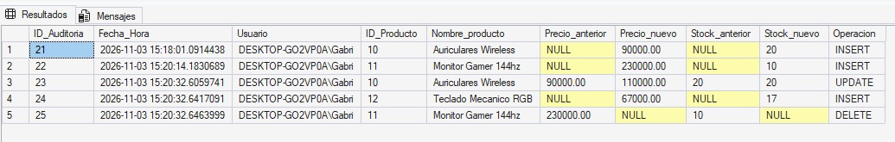

# Demostración

## Script SQL
`UPDATE Producto SET Precio_producto = 110000 WHERE ID_Producto = 10;
INSERT INTO Producto(Stock_producto,Nombre_producto,Precio_producto,ID_Empresa,ID_Proveedor)
VALUES (17,'Teclado Mecanico RGB',67000,1,1);
DELETE FROM Producto WHERE Nombre_producto = 'Monitor Gamer 144hz';`

## Resultado
Tras ejecutar la solicitud:
`SELECT * FROM auditoria_producto ORDER BY ID_Auditoria;`

El `UPDATE` muestra los _Auriculares Wireless_ con precio anterior 90000 y nuevo 110000, el `INSERT` muestra el _Teclado Mecanico RGB_ y el `DELETE` muestra el _Monitor Gamer 144hz_ con sus valores anteriores. Cada venta posterior a la creación del trigger agrega además una fila UPDATE con el stock anterior y el nuevo.
